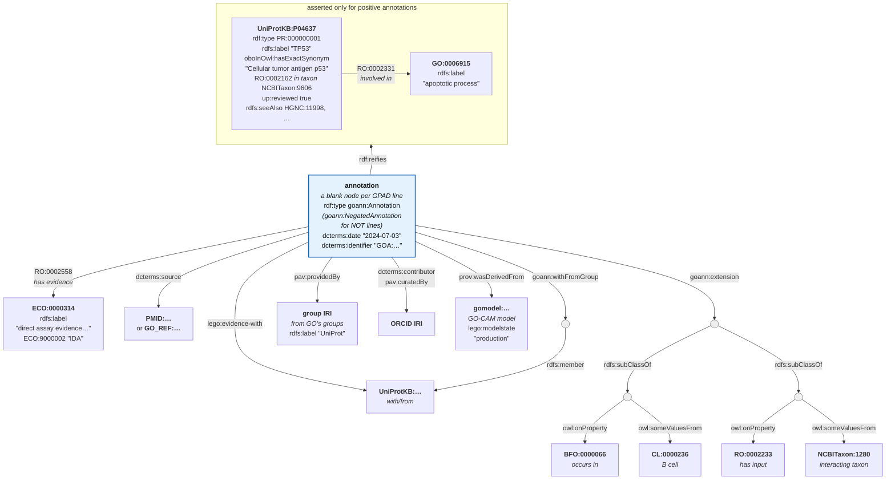

# go-annotation-kg

Converts a Gene Ontology release's annotations to RDF 1.2 and builds a KGF bundle of
them for the Open Knowledge Network. The aim is one canonical GO annotation graph
in the OKN.

The input is GO's per-species GPAD 2.0 and GPI 2.0 files, the `*-uniprot` pairs only.
The `*-mod` files repeat the same annotations keyed to MOD gene ids. Each gene
product → GO term relation is a plain triple, asserted once. Each GPAD line becomes a
reifier (`rdf:reifies`) of that triple, carrying the line's evidence, reference,
with/from, date, assigner, extensions and properties. `NOT` lines are reifiers typed
`goann:NegatedAnnotation` and never assert their triple. Positive lines are typed
`goann:Annotation`. [`docs/model.md`](docs/model.md) has the
model and the reasons for it, and [`docs/queries/`](docs/queries/) has SPARQL 1.2
examples.

One annotation, with every kind of property the graph gives it. The values are
examples; literal-valued properties are written inside their node, and grey circles
are blank nodes.



| Path | What it is |
|---|---|
| `src/main/scala/` | The converter: one GPAD/GPI pair to N-Triples 1.2, streamed with Jena. |
| `prefixes.tsv` | How every CURIE prefix in the files becomes an IRI, and why. |
| `ontologies.tsv` | Which OWL release labels the external terms of each namespace. |
| `vocab/goann.ttl` | The `goann:` vocabulary, loaded into every bundle. |
| `kgf/go-annotations.yaml` | The `kgf build` config, until the registry entry is merged. |
| `registry/go-annotations.md` | Draft entry for [okn-registry](https://github.com/frink-okn/okn-registry). |
| `Makefile` | Download, convert, report and bundle one GO release. |

## Running a release

Java 21 and [Scala CLI](https://scala-cli.virtuslab.org) are needed; `kgf` and `hdtc`
are needed for the bundle.

```bash
make test
```

```bash
make -j8 convert-all
```

```bash
make report
```

```bash
make bundle KGF=/path/to/kgf HDTC=/path/to/hdtc
```

`RELEASE` defaults to the current release, from
`https://current.geneontology.org/metadata/release-date.json`. The GPAD and GPI files,
and GO's `groups.ttl` and `db-xrefs.json`, are read from that release's pinned
snapshot at `https://release.geneontology.org/RELEASE/`, with the release's archive
DOI. ECO's OWL release, `eco.owl`, comes from `ECO_URL`, the current ECO by default;
its first download is kept for the release, and its version IRI is recorded in the
graph. Everything lands under `data/RELEASE/` (`DATA_ROOT` to move it). Pass
`RELEASE=YYYY-MM-DD` to rebuild an older one. Downloads and conversions are per species
and atomic, so an interrupted run picks up where it stopped. Try one species first
with `make convert SPECIES=HUMAN`.

`convert-all` ends with the labels step, `data/RELEASE/rdf/labels.nt.gz`: an
`rdfs:label` for each external term the release uses (GO, ECO, RO, NCBITaxon, and the
ontologies of extension targets), taken from the term's own ontology's OWL release as
`ontologies.tsv` lists, plus GO_REF titles. Only labels of used terms are kept. The
ontologies are streamed from the network, about 4.8 GB for 2026-08-05 (most of it
NCBITaxon, PR and CHEBI), and never stored; `labels.report.tsv` counts what each one
labelled and lists what nothing labelled.

The bundle's version label is the GO release date. To replace a release's bundle after
fixing the converter, run `make bundle REPLACE=1`: the new bundle is built under
`BUNDLE_ROOT/.staging/` and moved into place, and the old one is moved to
`BUNDLE_ROOT/.replaced/`, for you to delete when the new one is out. The manifest's
`previous_version` is set from the newest bundle of an earlier release.
[`docs/model.md`](docs/model.md) describes the provenance the graph records.

`make report` sums every species' counters into `data/RELEASE/report.tsv`. Read its
`dropped.*` lines after each release: a prefix GO starts using that
`prefixes.tsv` does not list shows up there as `dropped.*.unknown-prefix.PREFIX`, with
an example. Add the prefix to the table and convert again. `unresolved.assigned-by.*`
lines name assigners that GO's groups metadata lacks, which then appear as literals.

The bundle lands in `data/bundles/go-annotations/RELEASE`. For release 2026-08-05,
expect about 192M triples and a bundle of about 3 GB, so build on a machine with tens
of GB free.

## The converter alone

```bash
scala-cli run . --server=false -- --prefixes prefixes.tsv \
  --gpad HUMAN-uniprot.gpad.gz --gpi HUMAN-uniprot.gpi.gz \
  --report HUMAN.report.tsv --output HUMAN.nt.gz
```

Input compression is detected; output is gzipped when its name ends in `.gz`. The
output is written to a temporary file and moved into place only when the conversion
succeeds. `--strict` fails without output if any GPAD line or annotation was dropped.
`make build` packages `target/go-annotation-kg.jar`, which the Makefile runs.
